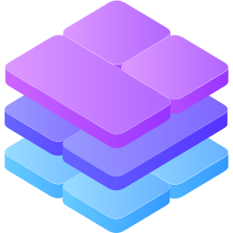

<div align="center">
  
</div>

# Stacklab

**Docker Compose setups for home servers and small teams.**

Choose an application, follow one recommended setup, and understand how to keep its data and update it. This repository provides deployment configurations and operating instructions using upstream container images.

## Browse deployments

The [app and stack catalog](docs/catalog.md) is the single inventory of available deployments and their purpose. Future ideas are tracked separately in the [wishlist](docs/wishlist.md).

## Start with Stirling PDF

Install [Docker Engine](https://docs.docker.com/engine/install/) and the Docker Compose plugin (`docker compose`). Then:

```bash
git clone https://github.com/smashaan/stacklab.git
cd stacklab/apps/stirling-pdf
docker compose up -d
docker compose ps
```

Open <http://localhost:8080> on the Docker host. Follow the [app guide](apps/stirling-pdf/README.md) for first login, remote-server access and resource requirements. Existing users of the old bind mount setup should read its migration note before starting this configuration.

For Stirling PDF, customization is optional. Copy `.env.example` to `.env` only when changing its defaults. Other deployments may require `.env` for secrets or initial configuration. Every app and stack README must state whether the file is required before its quick start.

## What to expect

- Standalone products live in `apps/<name>/`.
- Optional Compose additions live in an app or stack `extensions/` directory.
- Grouped services that deliver a shared goal live in `stacks/<name>/`.
- One `compose.yaml`, one README, and an environment example when useful.
- One supported upstream stable image channel per deployment.
- Named volumes by default for application-managed data.
  Supported source variables can point selected mounts to absolute host paths when needed.
- Setup, data, update and recovery instructions close to the application.

Read the [deployment standard](docs/standards.md) for the complete contract.

Named volumes keep runtime data out of this checkout. They are not encryption or backups. Keep `.env`, credentials, mutable data and backup files out of Git.

## Documentation

The [documentation index](docs/README.md) links to shared operating guidance, deployment conventions, contributor standards and future ideas. Application-specific instructions remain beside each deployment.

Docker Compose is the primary deployment method. Portainer and Dockge can be used when an app or stack guide identifies a compatible workflow. Compatibility is not a blanket guarantee. Native installers, Kubernetes and custom image publishing are outside the current scope.

## Contributing

See [CONTRIBUTING.md](CONTRIBUTING.md), the [app template](templates/app/) and the [stack template](templates/stack/). Help with setup, documentation, testing and restore verification. Report vulnerabilities according to [SECURITY.md](SECURITY.md).

## License

Repository configurations and documentation use the [MIT License](LICENSE). Third-party applications and assets retain their upstream licenses.
